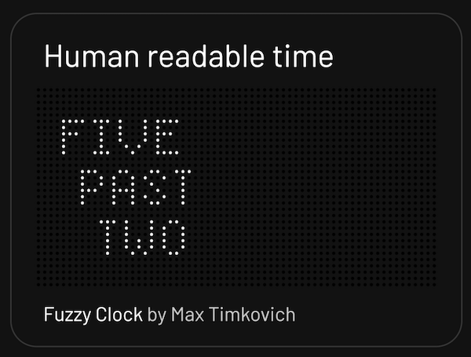
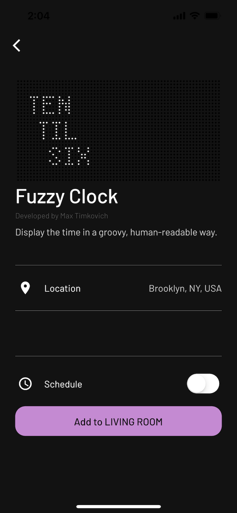

# Publishing Apps
So pumped you're here and want to publish an app! If you haven't done so already, check out the overview on [community apps](community-apps.md) to get a better sense of what you're getting yourself into. You'll also want to check out the guide on [authoring apps](../authoring-apps.md) to get a better sense of how everything works together.

One final note before we hop in - you may want to check out the [schema docs](../reference/schema/schema.md) if you haven't already. Schema allows you to display options inside of the Tronbyt app so the user can configure your starlark applet.

## Quick Start
Fork and clone the [Tronbyt apps repo](https://github.com/tronbyt/apps) to your local machine, and then run the following from the local folder to generate everything you need!
```
pixlet create
```

Once created, edit `apps/{{appname}}/{{app_name}}.star` with your source code.

When you're ready to publish, run the following to ensure your app is ready:
```
pixlet check apps/{{appname}}/{{app_name}}.star
```

## Detailed Instructions

### 1. Fork the Tronbyt Community repo on GitHub

- Community apps are published by making a Pull Request to the apps repo here: https://github.com/tronbyt/apps
- Start by forking the repo into your GitHub account.
- After forking you may want to checkout to a new branch to avoid any headaches, and to not have to merge off the main branch of your forked repo.

### 2. Clone the apps repo to your local machine

### 3. Create your app

- Run `pixlet create` via the terminal

This should be run from the 'community' repo folder on your local machine.
You will be prompted for the relevant information about your app and the required files and folders will be generated.

```
$ pixlet create
Name (what do you want to call your app?): Tides
Summary (what's the short and sweet of what this app does?): Tide charts
Description (what's the long form of what this app does?): Daily tide charts for your location.
Author (your name or your Github handle): Mark Spicer
```

Please note:

- **Name:** The App Name can contain spaces but should not have any numbers
- **Summary:** This should be a VERY brief summary of what the app does. (27 characters or less!)
- **Description:** This is a longer description of what the app does.

#### Example App
In this example, the fields map as follows:

- **Name**: Fuzzy Clock
- **Summary**: Human readable time
- **Description**: Display the time in a groovy, human-readable way.
- **Author**: Max Timkovich






#### Run your App

Preview your App in your browser at http://localhost:8080/ by running:

```
pixlet serve apps/{{appname}}/{{app_name}}.star
```

#### Generate a Screenshot

You can generate an enlarged screen render by entering:

```
pixlet render apps/{{appname}}/{{app_name}}.star --format gif --magnify 10
```

#### The manifest

Every app has a `manifest.yaml` next to its `.star` file, which describes the app to Tronbyt servers and the [App Viewer](https://apps.tronbyt.com/).
`pixlet create` fills in the basics from your answers; add the other fields yourself.
For example:

```yaml
id: tides
name: Tides
summary: Tide charts
desc: Daily tide charts for your location.
author: Mark Spicer
fileName: tides.star
packageName: tides
recommendedInterval: 15
supports2x: true
supports64x64: true
category: weather
tags:
  - outdoors
  - ocean
```

| Field | Description |
| --- | --- |
| `id` | The app's unique identifier, in lowercase with hyphens. |
| `name` | The app's name, as shown in app listings. |
| `summary` | A very brief summary (27 characters or less). |
| `desc` | A longer description of what the app does. |
| `author` | Your name or handle. Will be displayed publicly. |
| `fileName` | The app's `.star` file. Defaults to the package name plus `.star`. |
| `packageName` | The app's package name, usually the same as its folder name. Preview images are named after it (see below). |
| `recommendedInterval` | How often, in minutes, the app should be re-rendered. Shown as the recommended render interval in the app's settings. |
| `supports2x` | `true` if the app supports 2x (128x64) displays. See [2x Apps](../reference/2x-apps.md). |
| `supports64x64` | `true` if the app adapts its layout for square (64x64) displays. Checks fail if an app checks for a square display without this flag. |
| `category` | One category from the apps repo's [`categories.yaml`](https://github.com/tronbyt/apps/blob/main/categories.yaml), such as `weather` or `sports`. Checks fail for any other value. |
| `tags` | Optional keywords that help people find the app. |
| `minPixletVersion` | Optional. The oldest Pixlet version the app works with, e.g. `v0.55.0`. Pixlet refuses to run the app on anything older, so set it when the app uses a recent Pixlet feature. |
| `broken` and `brokenReason` | Set by maintainers when an app stops working (see below). |

`published` and `updated` are added and kept up to date automatically when your pull request is opened, so don't set them yourself.

#### Preview images

The image shown for your app on Tronbyt servers and in the App Viewer is a render saved in the app's folder, named after its `packageName`:

```
pixlet render -z 9 apps/{{appname}}/{{app_name}}.star -o apps/{{appname}}/{{packageName}}.webp
```

- For 2x support, add a 2x render as `{{packageName}}@2x.webp` (render with `-2`).
- For square displays, add a 64x64 render as `{{packageName}}@64x64.webp` (render with `-w 64 -t 64`).
  Unlike `@2x`, this image doesn't mark the app as supporting square displays: set `supports64x64` for that.
- Use a render that shows the app working with its default settings, not an error or setup message.

#### Broken apps

If an app stops working and can't be fixed for now (for example, the service it uses has shut down), it is marked broken in its manifest:

```yaml
broken: true
brokenReason: 'api.example.com: no such host'
```

Tronbyt servers then show a **BROKEN** badge with the reason, and the App Viewer shows a warning.
Checks skip broken apps.
When you fix an app, remove both lines in the same pull request, so the checks run on it again.

### 4. Making a PR

Before submitting your app, run `pixlet check apps/{{appname}}/{{app_name}}.star` to check your code for errors.

When you go to make a PR, give us a little background on what your app does. In addition, include a render from the following command so we can ooh-ahh:
```
pixlet render apps/{{appname}}/{{app_name}}.star --format gif --magnify 10
```
